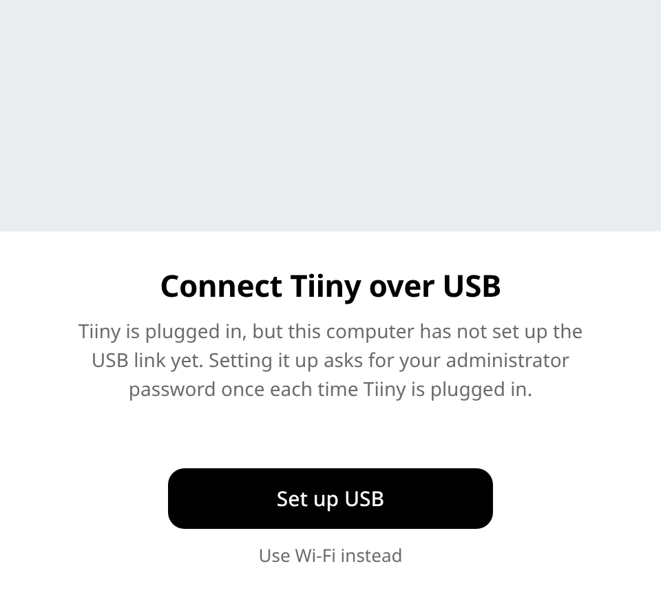
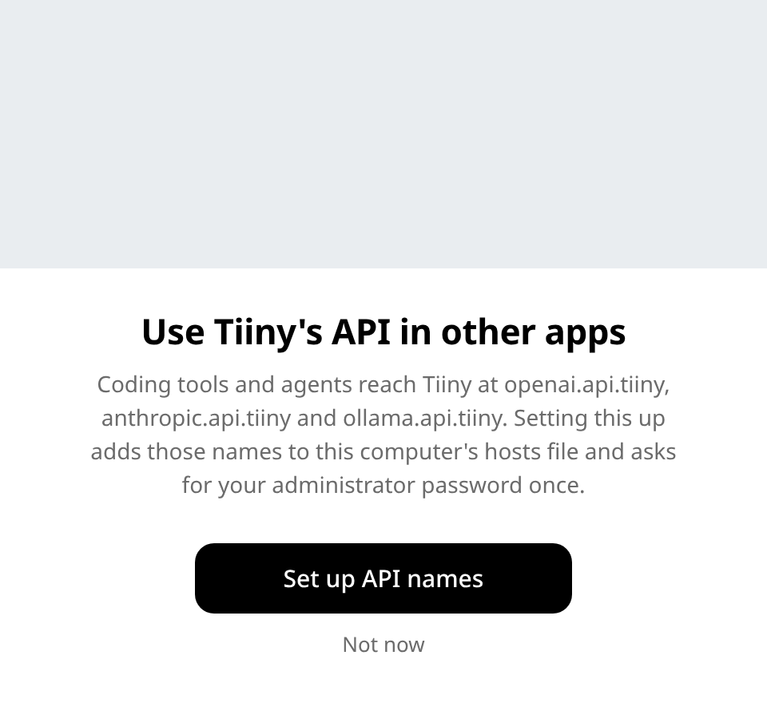

# TiinyOS on Linux

Run Tiiny's official TiinyOS desktop app on Linux, with a Tiiny box on
USB or Wi-Fi. Unofficial; not affiliated with or endorsed by Tiiny AI.

TiinyOS ships for Windows and macOS only: an Electron app plus a Go
service, `pcsvr`, that Wine cannot run. This project runs the official
app under Electron and replaces `pcsvr` with a Linux service written
from scratch for the same HTTP API. No Tiiny code is in this repository:
on first start, and whenever Tiiny releases a new version, the launcher
downloads the official build from Tiiny.

## Install

Needs `python3`, `7z` (p7zip) and Go 1.25.

```sh
pack/build.sh
dist/tiinyos
```

`dist/tiinyos` is one 10 MB executable. It adds TiinyOS to the app menu,
then downloads TiinyOS (about 140 MB) and Electron (110 MB) to
`~/.local/share/tiinyos`. To run from the source tree instead:
`(cd pcsvr && go build -o ../linux/pcsvr.new .) && linux/tiinyos.sh`.

## What it adds

<p>


</p>

- **USB without a network daemon.** If no NetworkManager takes the box's
  USB link, TiinyOS asks once (polkit password prompt) and sets it up
  itself. Wi-Fi needs nothing.
- **API names for other programs.** One prompt makes
  `http://openai.api.tiiny/v1`, `anthropic.api.tiiny` and
  `ollama.api.tiiny` work system-wide, over USB or Wi-Fi. Without it,
  the box's mDNS names (`openai.api.tiiny.local`) still work.
- **Switching** between USB and Wi-Fi while the app runs, with no restart.

(The photo the real prompts show is Tiiny's, so it is left out here.)

## Status

Tested with TiinyOS 1.0.3 and a real box under Xvfb and on KDE Wayland:
chat, model store, dashboard, vault, history, agent store, settings,
box OS update, power cycles, USB and Wi-Fi, the KiloCode integration
(VS Code, Cursor or VSCodium). Not ported: OCR (no Linux build of its
addon). Tiiny's store offers its other agent integrations (OpenCode,
Goose and the rest) for macOS and Windows only. x64 only. Details:
[docs/how-it-works.md](docs/how-it-works.md).

## Tests

```sh
(cd pcsvr && go test ./...)
python3 -m unittest discover -s tests
```

## Layout

| Path | What it is |
|---|---|
| `pcsvr/` | Linux PC service |
| `linux/` | Launcher, Electron entry, setup prompt, configs |
| `pack/` | Downloads the official app and Electron; builds `dist/tiinyos` |
| `repackage/` | Self-extractor for the launcher files |
| `docs/` | How it works, API reference, provenance ledger |

## License

MIT (`LICENSE`) for this repository. TiinyOS stays under Tiiny's terms.
